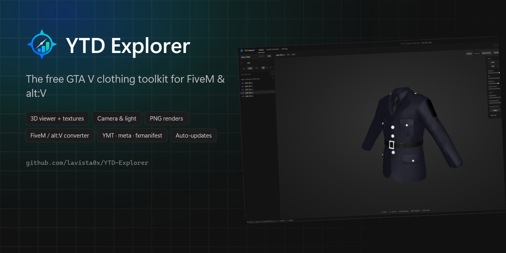
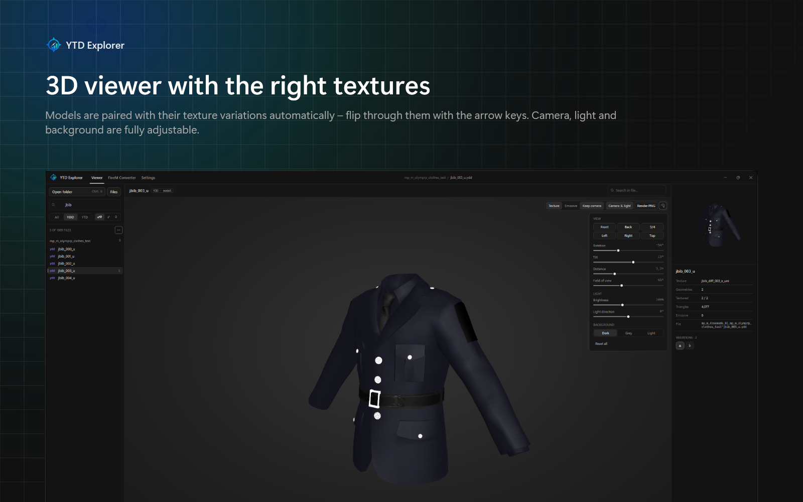
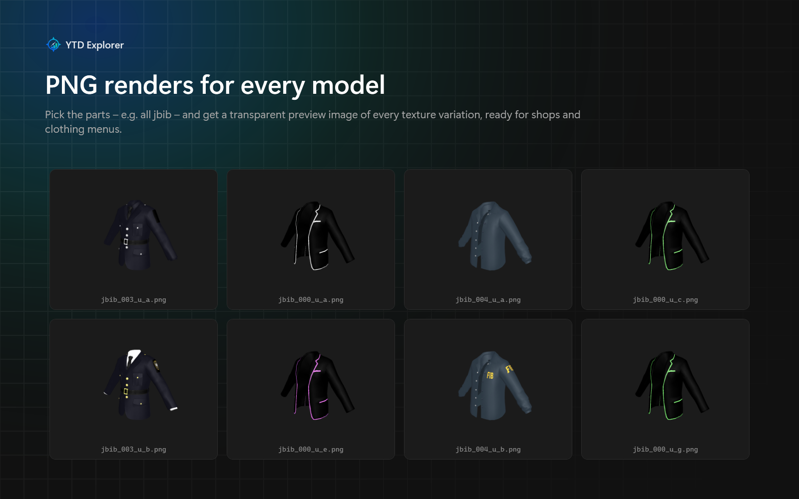
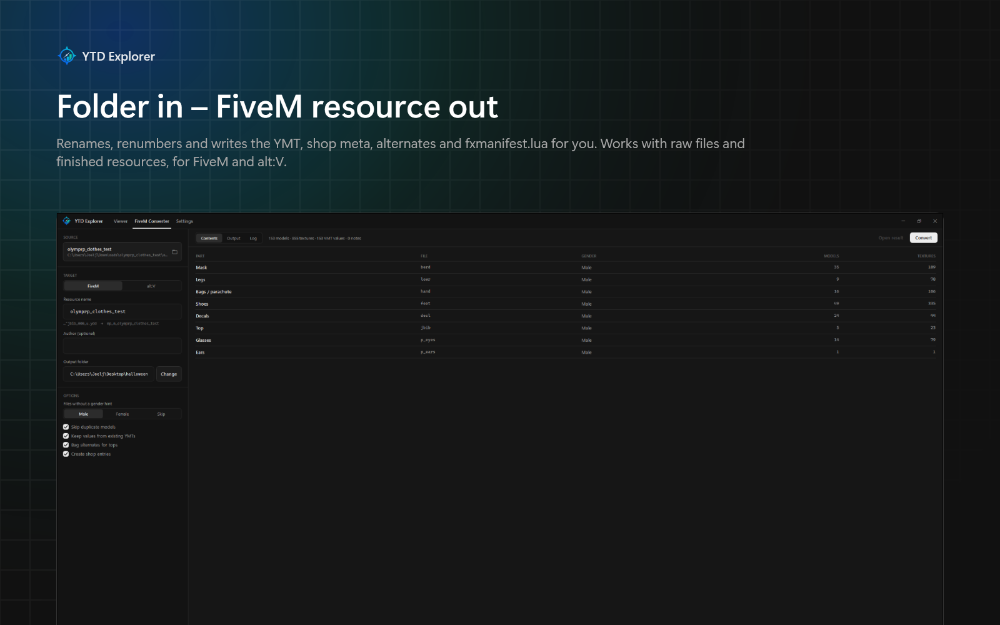

  

<h1 align="center">YTD Explorer</h1>

  <b>Free GTA V clothing toolkit for FiveM &amp; alt:V</b> 
  View YDD models with their YTD textures in 3D, render preview images and turn a folder of clothes into a ready-to-use resource.

  <a href="https://github.com/lavista0x/YTD-Explorer/releases/latest"><b>⬇ Download the latest version</b></a>
  &nbsp;·&nbsp; Windows 10 / 11 (x64) &nbsp;·&nbsp; English / Deutsch

---

## Features

### 3D viewer
- Open a folder (or drag it onto the window) – thousands of files open instantly, files are only read when you look at them
- Models are shown **with the right textures**: `…^jbib_000_u.ydd` is paired with `…^jbib_diff_000_a_uni.ytd`, `_b_`, `_c_` … automatically – never mixing male/female or different packs
- `↑ ↓` next model · `← →` next texture variation · click the `a b c …` chips in the inspector
- **Camera & light panel**: rotation, tilt, distance, field of view, brightness, light direction, background, presets (front / back / sides / top / ¾)
- BC7, DXT1/3/5 and uncompressed textures, transparency preview, emissive highlight

### PNG renders
- Preview images for every model of the selected parts – e.g. **all `jbib`** – in every texture variation
- 256 / 512 / 1024 px, transparent background, uses the current camera
- File names like `jbib_000_u_a.png` or the `11_0_0.png` (component_drawable_texture) style many FiveM clothing menus expect

### Resource converter (FiveM / alt:V)
Pick a folder with raw files *or* finished resources, choose FiveM or alt:V – done:
- renames and renumbers everything (`mp_m_freemode_01_mp_m_<name>^jbib_000_u.ydd`, textures `a, b, c …`)
- generates the creature **YMT**, **shop meta**, `pedalternatevariations.meta` and `fxmanifest.lua` (or `resource.toml` + `stream.toml`)
- keeps flags / audio / cloth settings from existing YMTs, skips duplicates, carries `_u_1` alternates and `.yld` cloth files
- male/female detected from prefixes or folder names (`male`, `[female]`, …), splits into several collections above 128 drawables per component
- output layout is compatible with Durty Cloth Tool resources

### Also
- Export textures as PNG + DDS, export single drawables, merge YTDs / YDDs
- English and German UI · Discord activity (can be turned off) · **automatic updates**

## Install
1. Download `YTD-Explorer-Setup-x.y.z.exe` from [Releases](https://github.com/lavista0x/YTD-Explorer/releases/latest)
2. Run it – no admin rights needed, no .NET installation needed

The app checks GitHub for new versions on start and offers **“Update now”** – the update downloads, installs and restarts the app by itself.

## Credits
- File formats: [CodeWalker](https://github.com/dexyfex/CodeWalker) by dexyfex (CodeWalker.Core)
- BC7 decoding: [BCnEncoder.NET](https://github.com/Nominom/BCnEncoder.NET) · Discord: [discord-rpc-csharp](https://github.com/Lachee/discord-rpc-csharp)
- See [THIRD_PARTY_NOTICES.md](THIRD_PARTY_NOTICES.md)

YTD Explorer is a free community tool and is not affiliated with Rockstar Games, Take-Two, Cfx.re, alt:V, OpenIV or Durty Cloth Tool.

---

## Deutsch

**YTD Explorer** ist ein kostenloses Tool für GTA-V-Kleidung:

- **Modelle (YDD) mit den passenden Texturen (YTD) in 3D ansehen**, mit Pfeiltasten durchblättern
- **Kamera und Licht frei einstellen** und **PNG-Vorschaubilder** für alle Teile (z. B. alle jbib) in jeder Textur-Variante rendern
- **Ordner rein → fertige FiveM- oder alt:V-Resource raus**: Umbenennen, Nummerieren, YMT, Shop-Meta, Alternativen und fxmanifest werden automatisch erzeugt (kompatibel zum Durty-Cloth-Tool-Aufbau)
- Deutsch / Englisch, Discord-Aktivität, **automatische Updates**

**Installation:** Neueste `YTD-Explorer-Setup-x.y.z.exe` unter [Releases](https://github.com/lavista0x/YTD-Explorer/releases/latest) herunterladen und starten. Keine Adminrechte nötig. Neue Versionen meldet die App beim Start selbst und installiert sie mit einem Klick.
